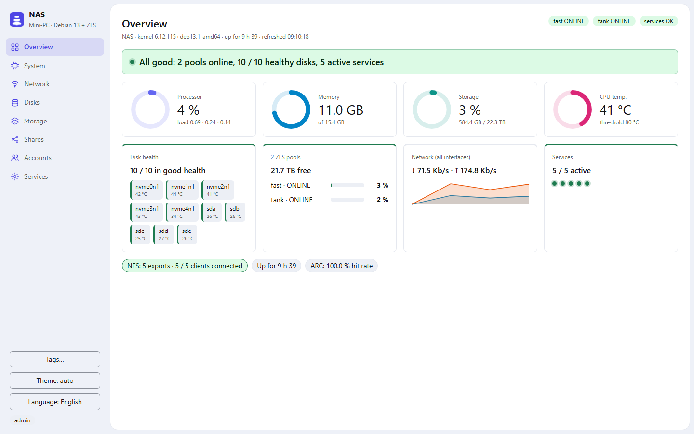
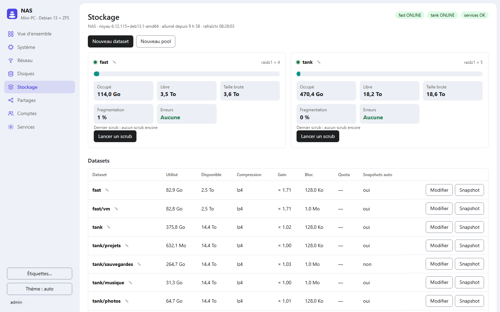
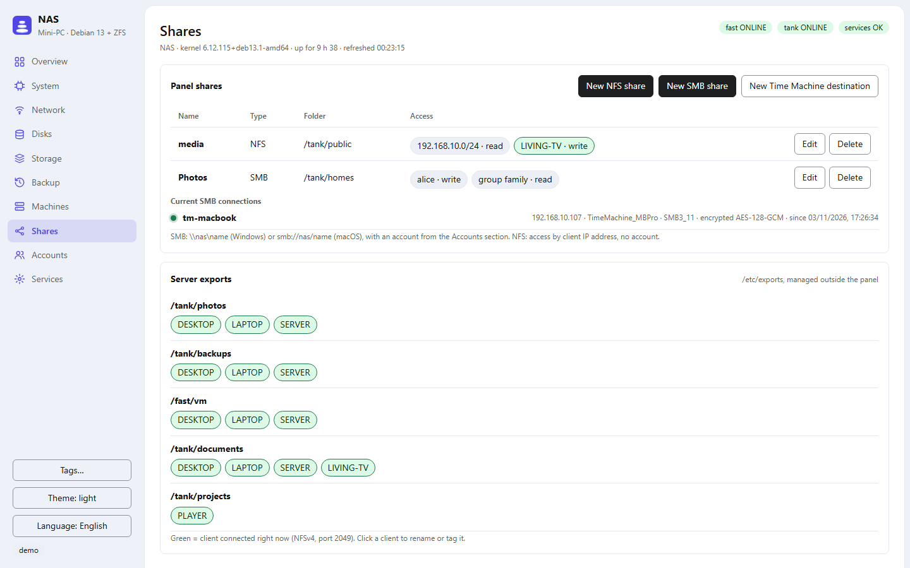
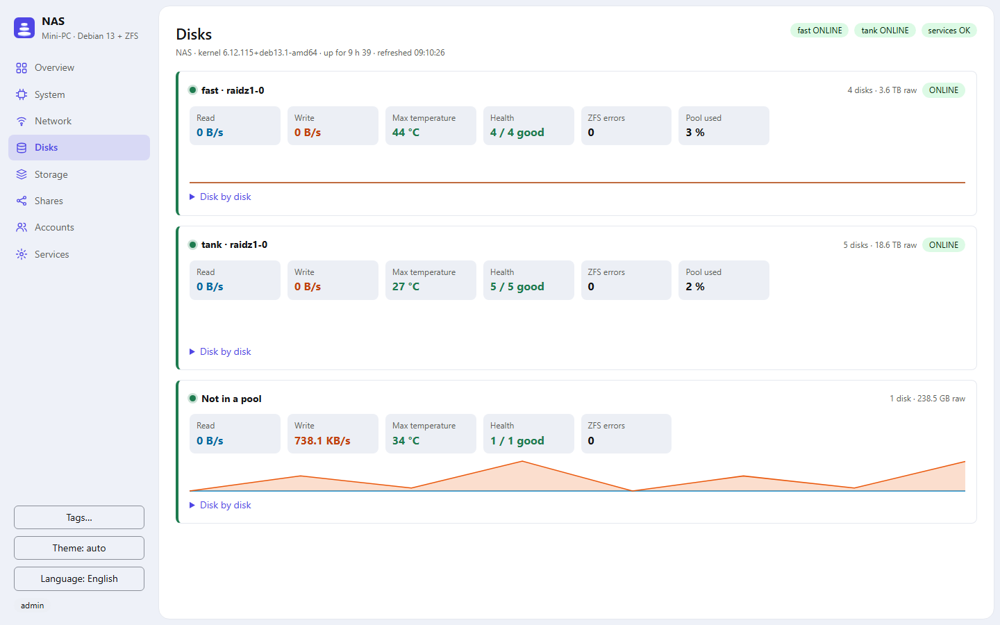
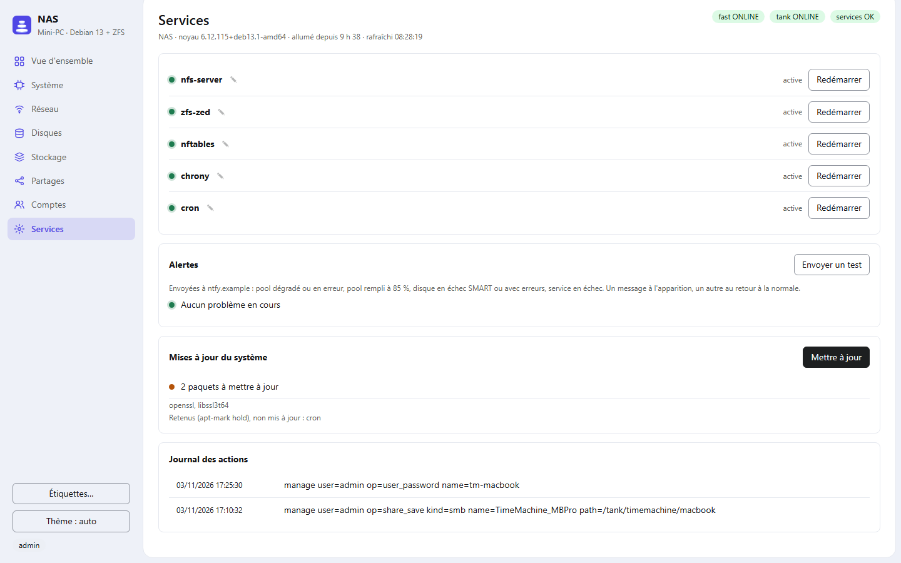

<p align="center"></p>

# Cairn (`cairn-nas`)

[](https://github.com/JBelliriGenty/Cairn-NAS/actions/workflows/ci.yml)

A web admin panel for a small **Debian + ZFS** NAS. One Rust binary with the
page embedded: no database, no third-party JavaScript, a few MB of RAM.

> Interface in English and French. Early days: it runs every day on its
> author's NAS, but the standalone installer has seen little testing on
> fresh machines. Issues and pull requests are welcome.

<picture><source media="(prefers-color-scheme: dark)" srcset="docs/screenshots/overview-dark.png"></picture>

<table>
<tr><td><picture><source media="(prefers-color-scheme: dark)" srcset="docs/screenshots/stockage-dark.png"></picture></td><td><picture><source media="(prefers-color-scheme: dark)" srcset="docs/screenshots/partages-dark.png"></picture></td></tr>
<tr><td align="center">Storage</td><td align="center">Shares</td></tr>
<tr><td><picture><source media="(prefers-color-scheme: dark)" srcset="docs/screenshots/disques-dark.png"></picture></td><td><picture><source media="(prefers-color-scheme: dark)" srcset="docs/screenshots/services-dark.png"></picture></td></tr>
<tr><td align="center">Disks</td><td align="center">Services</td></tr>
</table>

Screenshots follow your GitHub theme (light or dark); the panel has both.
Demo data.

## What it does

- **Overview**: CPU, memory (including the ZFS ARC), network, disks and
  temperatures, live.
- **Disks**: SMART health (NVMe wear, reallocated sectors, errors).
- **Storage**: ZFS pools, datasets (compression, quota, automatic
  snapshots on/off) and volumes (zvols: size, space used, ratio), manual
  snapshots, scrub.
- **NFS and SMB shares**: created from the page, access by account or group,
  SMB3 minimum, encryption preferred or required, Time Machine, Windows
  Previous Versions, recycle bin, per-share firewall opening (nftables).
  Current SMB sessions.
- **Time Machine wizard**: account + preset share in one form (on an
  existing dataset, or a new one when `features.pools` is on). Macs find it
  through Bonjour (avahi).
- **Accounts**: Linux accounts without login (no shell, no SSH) with a Samba
  password, and groups.
- **Services**: state, restart, pending updates, journal of the actions done
  from the page.
- **Alerts**: degraded or full pool, failing disk, failed service, sent to
  ntfy or any webhook (text POST).
- **Dashboards**: read-only JSON summary for Homepage and the like.

Optional (off by default): creating and deleting datasets, volumes and
pools, growing, exporting, importing and upgrading pools (`features.pools`,
see below); log, cache and spare devices and trim (`features.vdevs`);
replacing a pool's disks
(`features.disks`); pull replication between two Cairn machines
(`features.replication`); iSCSI export of volumes (`features.iscsi`);
snapshot restore (`features.restore`); snapshot, scrub and SMART
self-test schedules (`features.schedules`); native encryption
(`features.encryption`); off-site backups with restic (`features.offsite`),
see below.

## Snapshot restore (`features.restore`)

In **Storage**, *Restore…* on a dataset or volume that has snapshots: pick
one (automatic ones included), then:

- *Browse it* (datasets only): its folders as they were, read-only from
  `<mountpoint>/.zfs/snapshot/<name>`. *Download* a file, or a folder as a
  `.tar`, up to 4 GiB; *Restore* copies the file or folder back into the
  dataset next to the original, as `<name>.restored-<snapshot>`: nothing is
  ever overwritten, and an existing copy of that name is refused. Paths are
  resolved on the server (symlinks and `..` included) and must stay inside
  the snapshot.
- *Clone it* into a new dataset of the same pool (`zfs clone`): a writable
  copy sharing its blocks; the snapshot cannot be deleted while it exists.
- *Roll the dataset back* (`zfs rollback`): everything written since is
  lost. The dataset name must be typed again and the page lists the newer
  snapshots destroyed with it (`-r`). Refused when a newer snapshot has a
  clone (that would need `-R`), and while a replication (either side, or a
  replicated parent) or an iSCSI export uses the dataset.

## Schedules (`features.schedules`)

Nothing changes until a schedule is edited in the page.

- **Automatic snapshots** (with `features.autosnap`): Cairn drives the
  existing `zfs-auto-snapshot` package, no second snapshot tool. *Edit* on a
  dataset ticks the rotations it takes part in (every 15 min, hourly,
  daily, weekly, monthly), written as `com.sun:auto-snapshot` and
  `com.sun:auto-snapshot:<label>` properties (inherited by children). The
  card above the snapshots sets how many of each are kept: the `--keep=` of
  `/etc/cron.d/zfs-auto-snapshot` and `/etc/cron.{hourly,daily,weekly,monthly}/zfs-auto-snapshot`,
  for the whole machine. A replication pulling from the machine needs its
  last copied snapshot to survive the rotation.
- **Scrub** per pool, weekly or monthly, through the OpenZFS timers
  `zfs-scrub-weekly@<pool>.timer` / `zfs-scrub-monthly@<pool>.timer`
  (Debian's own monthly scrub in `/etc/cron.d/zfsutils-linux` is left alone).
  The pool card shows the schedule; a scrub that found errors raises an alert.
- **SMART self-tests**: short (daily or weekly) and long (weekly or
  monthly) tests of every disk at 01:30, through the units
  `cairn-smart-{short,long}.{service,timer}` that run `cairn-nas --selftest
  short|long`. Each disk card shows the last self-test result; a failed one
  raises an alert.

## Native encryption (`features.encryption`)

In **Storage**, *New encrypted dataset* creates a dataset with ZFS native
encryption (`encryption=on`) under an existing one, keyed either by a
**passphrase** (asked at each unlock, sent to `zfs` on stdin, never stored
nor logged) or by a **key file** of 32 random bytes,
`/etc/cairn-nas/keys/<dataset with / as _>.key` (directory 0700, file
0600, root only). Existing datasets cannot be encrypted in place: create an
encrypted one and copy the data into it.

The *Encryption* column shows each encrypted dataset's key status and, on
its encryption root, *Unlock* (`zfs load-key`, then mounts its file systems)
or *Lock* (`zfs unmount -u`: unmounts them and forgets the key; refused
while a share, a replication, an iSCSI export or an off-site backup uses
them). Key-file datasets can be unlocked at boot: the unit
`cairn-unlock.service` loads their keys before `zfs-mount.service` (Debian
masks `zfs-load-key.service`). Passphrase datasets stay locked after a
reboot until unlocked from the page. A key file protects disks taken out of
the machine, not the machine itself; a lost passphrase or key file means
lost data.

## Off-site backup with restic (`features.offsite`)

Needs `restic` (`apt install restic`). In **Backup**:

- **Repositories**: a local folder or disk (`/path`), an SFTP server
  (`user@host:/path`, with this machine's own key `/var/lib/cairn-nas/restic_ed25519`,
  created from the page, to add to the server's `authorized_keys`), S3-compatible
  storage (`https://endpoint/bucket/path`) or Backblaze B2 (`bucket:path`).
  An existing repository with the same password is used as it is, otherwise
  it is created (`restic init`). The password and the access keys go to
  root-only files, `/etc/cairn-nas/restic/<name>.pass` and `.env` (directory
  0700, files 0600), and are never returned by the API. Removing a
  repository only removes this machine's access, never the copies.
- **Backups**, one per dataset: daily (04:00) or weekly (Sunday 04:00),
  through `cairn-backup-{daily,weekly}.{service,timer}` running
  `cairn-nas --backup <every> <config>`. Each run takes a fresh snapshot
  `<dataset>@cairn-restic-<time>`, bind-mounts it read-only on the stable
  path `/run/cairn-nas/restic/<dataset>` (so restic finds the previous copy
  and only reads changed files), backs it up tagged with the dataset name,
  releases the snapshot, then applies the retention
  (`forget --prune --keep-daily/--keep-weekly/--keep-monthly`). Child
  datasets are not included. The last run of each job is shown
  (`/var/lib/cairn-nas/restic-status.json`); a failed run, or no successful
  run for 26 h (daily) or 8 days (weekly), raises an alert. *Run now* starts
  one in the background.
- **Restore**: a copy, a file or folder of it (or everything), into a new
  folder inside a dataset; nothing is overwritten.

A dataset with a backup cannot be deleted or locked until its backup is
stopped.

## Datasets, volumes and pools (`features.pools`)

In **Storage**: *New dataset*, *New volume* (zvol: size such as `100G` or
`1.5T`, thin or fully reserved, block size 8K to 128K, compression; it can
grow, never shrink), *New pool* on blank disks only, and *Delete* on
datasets, volumes and pools.

Deletion is permanent, snapshots included. The server refuses rather than
warns:
- unless the full name (or the pool name) is typed again;
- while an NFS or SMB share of the panel, a path of `/etc/exports`, an
  iSCSI export or a replication points into it (children included);
- a dataset with child datasets, unless *With its children* is ticked
  (`zfs destroy -r`); its own snapshots always go with it;
- the root dataset of a pool: delete the pool instead (`zpool destroy`,
  never forced; the disks are left as they are, not wiped).

Never `-f` or `-R`: a busy mount, a hold or a clone makes `zfs` refuse, and
its message is shown. Every deletion is in the action journal.

## Pool layout and maintenance (`features.vdevs`, `features.pools`)

Each pool card in **Storage** shows its ashift, automatic trim and whether
ZFS features are left to enable; its log, cache and spare devices show in
the pool summary and, with their role, as cards of their own in **Disks**.
Under *Layout and maintenance*:

- With `features.vdevs` (reversible changes only): *Add a log device
  (SLOG)*, one disk or two to three mirrored; *Add a cache device (L2ARC)*;
  *Add a spare disk*; *Remove from the pool* on a log, cache or spare card
  (`zpool remove`; a spare standing in for a failed disk is refused); *Trim
  now* and automatic trim on or off. A SLOG only helps synchronous writes
  (NFS, VMs, databases) and should be an SSD with power-loss protection: the
  page says so, it cannot check it.
- With `features.pools` (also the above): *Add a data group* (the existing
  groups' layout is offered first; a group with less redundancy than the
  existing ones is refused, the rest is left to `zpool add`'s own checks,
  never `-f`); *Expand a RAIDZ group* by one disk (`zpool attach`, OpenZFS
  2.3 or later, the pool's `raidz_expansion` feature must be enabled;
  progress shows like a resilver); *Export* (refused while a share, an
  export or a replication uses the pool); *Import a pool* from the pools
  `zpool import` finds, by id, never forced (a pool not exported by another
  machine stays there); *Enable new ZFS features* (`zpool upgrade`, after a
  warning that older systems can no longer import the pool).

Adding needs blank disks, the pool name typed again, and erases the chosen
disks. A removed device keeps its ZFS label: it is offered as a free disk
again only once erased (`wipefs -a`).

## iSCSI export of volumes (`features.iscsi`)

Needs `targetcli-fb` (LIO, the kernel's own target). In **Storage**, each
volume gets *Export over iSCSI*: one target per volume
(`<iscsi_base>:<pool>.<volume>`, `iscsi_base` defaults to
`iqn.2003-01.org.linux-iscsi.<hostname>`), its single LUN, and access only
for the machines listed by their initiator name (on Linux and Proxmox:
`/etc/iscsi/initiatorname.iscsi`). There is no "open to all" mode and no
CHAP: restrict TCP port 3260 to those machines in your firewall. The
configuration is saved with `targetcli saveconfig` and restored at boot by
`rtslib-fb-targetctl`, which Cairn orders after `zfs-volumes.target`. An
exported volume, or its pool, cannot be deleted; *Stop the export*
disconnects the machines at once and keeps the data.

## Disk replacement (`features.disks`)

In **Disks**, each pool member gets *Take offline*, *Bring online* and
*Replace*. Replace runs `zpool replace` with a free disk (blank: no
partition, holder or signature, same rule as pool creation), named by its
`/dev/disk/by-id` path; the old disk stays in use until the resilver is done,
and its progress and time left show in **Storage** and **Disks**, refreshed
every 15 s. Offline and replace ask for the pool name to be typed again.

The server refuses:
- any action while a resilver or replacement runs in the pool (except
  *Bring online*);
- taking a healthy disk offline when its vdev would be left without
  redundancy (one disk of a two-way mirror, a second disk of a RAIDZ1…),
  which `zpool` itself allows: replace it instead, redundancy is kept during
  the copy. `zpool` refuses on its own to offline the last valid copy;
- log, cache and spare devices, and anything that is not a leaf of a data vdev.

## Replication (`features.replication`)

In **Backup**, with the feature on both machines. The backup machine pulls:
a compromised source can neither change nor delete its copies.

1. On the backup machine: *Create this machine's key*, copy the key shown.
2. On the source: *Allow a backup machine* with the backup machine's IPv4
   address, that key, and the datasets it may copy. The panel creates the
   system account `cairn-repl`, gives it `zfs allow send,hold` on those
   datasets only, and accepts the key from that address only
   (`from="…",restrict`).
3. On the backup machine: *New replication* (source machine, dataset,
   local dataset to copy into). The first copy starts at once, then every
   night at 03:00 (`cairn-repl.timer`, running `cairn-nas --pull`).

Requirements: `syncoid` on the backup machine (`apt install sanoid`, plus
`lzop mbuffer` for speed), SSH open from the backup machine to the source,
and automatic snapshots on the source: they are what is copied (no snapshot
of its own is created). The backup side keeps 4 quarter-hourly, 24 hourly,
62 daily, 16 weekly and 24 monthly snapshots per dataset; manual snapshots
are never pruned. Each copy shows in the Backup table and alerts after 26 h
without a new snapshot. *Stop* and *Revoke* never delete data.

## Machines (`peers`)

One Cairn can show the others at a glance, read-only. List them under
`peers`; a **Machines** view appears (and an Overview tile): one card per
machine, this one first, with its pools (health, % used), problem count and
messages, highest temperature, and an *Open* link to its own page. Overview
shows, under "Connected machines", each peer's own overview tiles (system,
disk health, pools, network, services, replication): they come from
`GET /api/summary?full=1`, which adds a `full` object to the summary.

```json
"peers": [{"name": "Backup", "url": "http://192.0.2.20:9091", "link": "https://backup.example.lan",
           "token_file": "/etc/cairn-nas-peer-backup-token"}]
```

The server (never the browser) fetches each peer's `GET /api/summary` every
30 s, in the background, with that peer's summary token (`summary_token_file`
on the peer; a root-only file here, sent to curl on stdin, never to the
page): a dead peer never slows the page. `url` is where this server reaches
the peer (it must be allowed to: the peer's firewall, and its
`trusted_proxies` do not matter since the token is enough); `link` is what the
browser opens, e.g. behind a reverse proxy. A peer unreachable for longer than
`peer_unreachable_minutes` (15) is alerted; its own problems are not, each
machine alerts on its own. The token opens nothing but `/api/summary`.

## Try it

`cairn-nas --demo` serves the page on sample data at `http://127.0.0.1:8080`
(or `--demo <address:port>`): no root, no ZFS needed, nothing is changed.

## Install (standalone mode)

Debian 13 with ZFS already set up (`zfsutils-linux`), as root, from the
[latest release](https://github.com/JBelliriGenty/Cairn-NAS/releases/latest)
(x86_64):

```sh
tar xzf cairn-nas-v*-x86_64-linux.tar.gz
cd cairn-nas-v*-x86_64-linux
sh install.sh
usermod -aG nas-admin <your-account>
```

Or from source (builds with Debian's `cargo`): `git clone` this repository and
run `sh install.sh` in it.

Then open `https://<address>:8443` and sign in with that system account. The
certificate is self-signed: replace `/etc/cairn-nas/cert.pem` and `key.pem`
with your own if you have one.

## Two authentication modes

- **Built-in sign-in** (`login` in the config, what `install.sh` sets up):
  HTTPS only (system OpenSSL), a system account member of `admin_group`
  checked against `/etc/shadow`, session cookie (`HttpOnly`, `Secure`,
  `SameSite=Strict`) expiring after `session_minutes` idle, delay doubled on
  each failure (up to 5 min) per address.
- **Behind an authenticating reverse proxy** (Traefik + Authelia, etc.):
  without `login`, the panel only answers the `trusted_proxies` addresses and
  reads the identity from `user_header` / `groups_header` (`require_groups`).

## Configuration (`/etc/cairn-nas.json`)

| Key | Purpose |
|---|---|
| `listen` | listen address:port |
| `title`, `subtitle` | page header |
| `login` | `{admin_group, session_minutes}`: built-in sign-in |
| `tls` | `{cert, key}` (PEM): HTTPS, required with `login` |
| `trusted_proxies`, `user_header`, `groups_header`, `require_groups` | proxy mode |
| `services` | systemd units shown and restartable |
| `features` | `{nfs, smb, users, pools, vdevs, disks, replication, iscsi, restore, schedules, encryption, offsite}`: allowed writes |
| `firewall_table` | nftables table holding the `cairn_nfs` / `cairn_smb` sets (absent: the firewall is never touched) |
| `alerts` | `{url, headers_file, capacity_pct, interval_s}` |
| `replication` | list of `{dataset, max_age_hours, snapshot_prefix}`: replicated datasets (with their children) shown in the Backup view (and an Overview tile) with their newest snapshot, alert past `max_age_hours` (26). On the receiving side any snapshot counts; on the sending side set `snapshot_prefix` to the one your tool creates per send (e.g. `syncoid_`) |
| `recycle_days` | how long the SMB recycle bin keeps files (30) |
| `lang` | `en` or `fr`: alerts, `/api/summary`, and the page's default when the browser asks for neither (`en`) |
| `nics`, `hosts` | display names of network interfaces and client machines |
| `peers` | list of `{name, url, link, token_file}`: other Cairn instances shown in Machines (see below) |
| `peer_unreachable_minutes` | alert when a peer stays unreachable this long (15) |
| `summary_token_file` | file holding the token (32 characters min.) that opens `GET /api/summary` to dashboards |

## Dashboards (Homepage…)

`GET /api/summary` returns, read-only:

```json
{"pools": {"tank": {"health": "ONLINE", "capacity": 3, "size": 20000588955648, "alloc": 685076635648}},
 "problems": 0, "messages": [], "temp_max_c": 46}
```

`capacity` in %, `size`/`alloc` in bytes, `problems` = current alerts (pools,
SMART disks, failed services, late replication). A signed-in session can read it; otherwise it
needs the `Authorization: Bearer <token>` header with the token from
`summary_token_file` (`openssl rand -hex 32 > /etc/cairn-nas-summary-token`,
`chmod 600`). [Homepage](https://gethomepage.dev) widget:

```yaml
widget:
  type: customapi
  url: https://nas.example:8443/api/summary
  refreshInterval: 300000
  headers:
    Authorization: Bearer <token>
  mappings:
    - field: { pools: { tank: capacity } }
      label: tank
      format: percent
    - field: problems
      label: Problems
      format: number
    - field: temp_max_c
      label: Temp.
      format: number
      suffix: " °C"
```

For the card icon, copy `www/icon.svg` into Homepage's `public/icons` and use
`icon: /icons/cairn.svg`.

## What it writes

Only its own files: `/etc/exports.d/cairn-nas.exports`,
`/etc/samba/cairn-nas.conf` (included by `smb.conf`),
`/etc/nftables.d/cairn-nas.nft`, and its state in `/var/lib/cairn-nas/`;
with replication, `/etc/systemd/system/cairn-repl.{service,timer}` and the
`cairn-repl` account's `authorized_keys`.
Writes are a closed list of validated actions, run without a shell and
logged with the account name (`journalctl -u cairn-nas`).

## Translations

The code is written in English. The page picks the viewer's choice (Language
button), then the server's `lang`, then the browser's language. To add a
language: copy the `fr` block of `www/i18n.js`, translate its values, add the
language to `LANGS`; server messages (errors, alerts) have their own table,
`FR` in `src/main.rs`.

## Build and test

```sh
cargo build --release --locked
cargo test --release --locked
```

Rust from Debian 13 (`cargo` 1.85) is enough. `DESIGN.md` describes the
visual design.

Each push runs the tests on GitHub Actions; a `vX.Y.Z` tag publishes a
release with the binary (see `CHANGELOG.md`). Security reports: `SECURITY.md`.

## License

MIT, see `LICENSE`.
